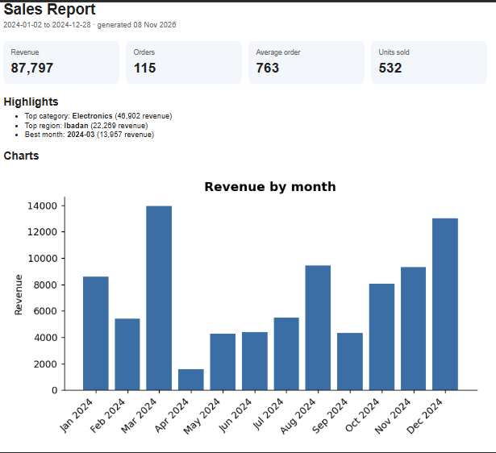
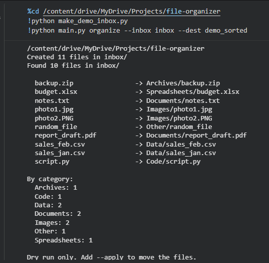

# File Organizer & Sales Report Generator

A Python toolkit that tidies a messy folder, cleans a messy sales CSV with pandas, and turns the result into charts and a self-contained HTML report, all from the command line.



## What it does

1. **Organize:** sorts the files in a messy folder into subfolders by type (Images, Documents, Spreadsheets, Data, Code, Archives, Other).
2. **Clean:** fixes a messy sales CSV and records exactly what was changed.
3. **Report:** builds charts and an HTML report with headline numbers and the cleaning summary.

## Features

- **Safe by default.** The organizer does a dry run unless you pass `--apply`, never overwrites an existing file (it adds `_1`, `_2`, ... instead), skips hidden files and subfolders, and logs every move to a CSV.
- **Auditable cleaning.** Every fix and removal is counted and shown in the report, so nothing disappears silently.
- **One-command pipeline.** `run` cleans the data and builds the report in a single step.
- **Self-contained report.** `report.html` embeds its charts, so it can be shared as a single file.



## Project structure

```
├── main.py              # command-line entry point (organize, clean, report, run)
├── organizer.py         # plans and applies file moves
├── cleaner.py           # pandas cleaning pipeline
├── report.py            # metrics, charts, and the HTML report
├── make_demo_inbox.py   # creates placeholder files to try the organizer on
├── make_messy_data.py   # generates the messy sample CSV
├── data/
│   └── sample_messy_sales.csv
└── requirements.txt
```

## Setup

```bash
pip install -r requirements.txt
```

## Usage

### Clean the data and build the report

```bash
python main.py run --input data/sample_messy_sales.csv
```

This creates an `output/` folder containing `clean_sales.csv`, `cleaning_summary.json`, three chart images, and `report.html`.

You can also run the two stages separately:

```bash
python main.py clean --input data/sample_messy_sales.csv
python main.py report
```

### Organize a folder

```bash
python make_demo_inbox.py                              # creates a practice folder called inbox/
python main.py organize --inbox inbox --dest sorted    # dry run: shows the plan, moves nothing
python main.py organize --inbox inbox --dest sorted --apply
```

## What the cleaner fixes

| Problem | How it is handled |
|---|---|
| Messy column names (` Order ID`, `REGION`) | Converted to `snake_case` |
| Extra spaces and inconsistent capitalization | Trimmed and converted to Title Case |
| Mixed date formats (`2024-05-02`, `02/05/2024`, `May 02, 2024`) | Parsed into real dates; unreadable dates are dropped |
| Currency symbols and separators (`$1,200.50`) | Converted to numbers; unreadable values are dropped |
| Placeholders (`N/A`, `-`, blanks) | Treated as missing values |
| Exact duplicate rows and repeated order IDs | Removed (first occurrence kept) |
| Negative or zero quantities and prices | Dropped as invalid |
| Missing region, category, or customer | Filled with `Unknown` |

Dates with a slash are read as day/month/year.

## Expected input columns

`order_id, date, customer, region, product_category, quantity, unit_price`

Header spacing and capitalization don't matter. Extra columns are ignored.

## Limitations and ideas

- The cleaner is written for this sales schema. Other datasets would need their own column rules.
- Files are sorted by extension only, not by content.
- Ideas: an `undo` command for the organizer (the move log already records everything needed), unit tests, and a scheduled run with GitHub Actions.

## Built with

Python, pandas, Matplotlib
